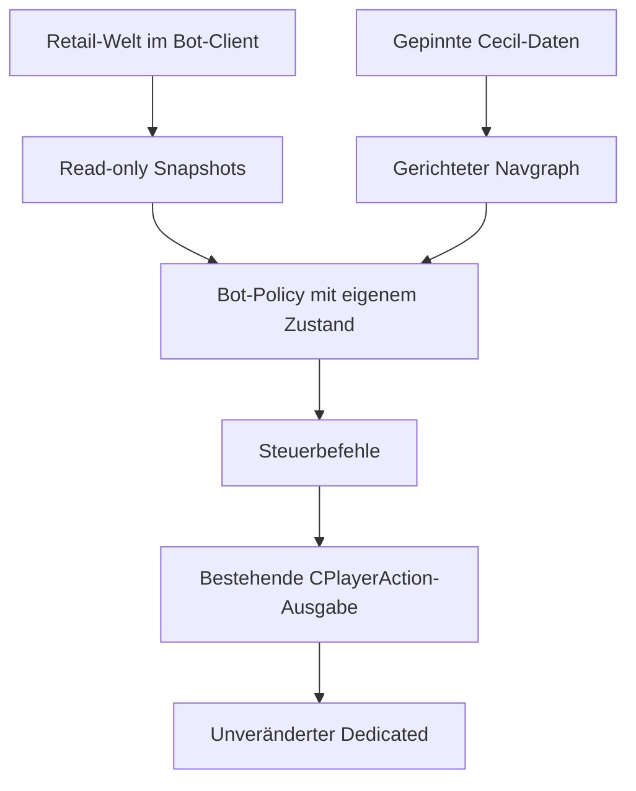

# Architektur, Wiederverwendung und Grenzen

## Originale Modstruktur

CPlayerBot erbt von CPlayer (Classes/PlayerBot.es:38). Der Controller hält CMovableEntity-Zeiger und umfangreichen Botzustand (BotStructure.h:146–162). Die Logik wird in **EntitiesMP**, nicht als unabhängige GameMP-Clientbibliothek gebaut: EntitiesMP.vcxproj:262–287 führt alle Logik-, Navmesh-, Patcher- und Entitydateien auf.

PlayerBot.es:117–173 ruft Thinking, Weapons und direkte Waffenauswahl auf, verändert Bewegungszustand und erzeugt Aktionen. Player.es ergänzt BotApplyAction-Pfade; Game.cpp übernimmt Lifecycle und Botverwaltung. Die wiederverwendete Entity-ID 410 belegt keine identische Klassenstruktur oder Netzwerkserialisierung.

CustomPackets.h:21–56 definiert eigene Nachricht 49 und Bot-/NAV-Operationen. NetworkPatch/ServerIntegration.cpp:35–67 verteilt eigene Streamblöcke und detourt ReceiveFromClient, ReceiveFromClientReliable sowie ProcessGameStreamBlock. Auch der ältere serverside-bots-Branch tut das; er erfüllt die Dedicated-Vorgabe nicht als Komplettlösung.

Die Wiki-Integrationswarnung betrifft Konflikte mit Serious Sam Classics Patch networking und verlangt Player-/Entity-/Game-Anpassungen. Sie verbietet technisch nicht die Wiederverwendung reiner Daten oder adaptierter Algorithmen.

## Zielarchitektur

Die Backend-Grenze ist eindeutig: Nur gewöhnliche Clientaktionen verlassen den Bot-Client. Keine eigenen Cecil-Pakete, kein Netcode-Patcher, kein CPlayerBot im Dedicated. Sicht-/Kollisions-/Itemabfragen erfolgen auf dem bestehenden Client-Weltzustand. Serverseitig autoritative Entitäten werden nicht verändert.

Vorgeschlagene explizite Strukturen:

- WorldSnapshot: tick, map fingerprint, generation, Botposition/orientation/alive, Gegner mit ID/generation, Team, Alive, Sichtbarkeit, Geschwindigkeit und erlaubter Gesundheitssicht.
- InventorySnapshot: ownedMask, Ammo je Waffe, current/requested weapon, aktuelle Auswahlbereitschaft.
- ItemSnapshot: ID/generation, Typ, Position, availability, Mengen-/Waffentyp; keine CEntity*-Lebensdauer über den Tick.
- NavPoint/NavArc: slot und stabile ID getrennt, FLOAT32-Position/Radius, Flags, gerichtete Verbindungen, Lock-/Important-Referenzen, explizite Bewegungsart.
- BotCommand: forward/strafe/up, yaw/pitch, fire, weapon, use/zoom. Der native Adapter validiert Grenzen und erzeugt reguläre CPlayerAction.

Mapwechsel invalidieren Entity- und Graphreferenzen. Graphdaten bleiben nach Veröffentlichung immutable; Suchkontext und Zufallszustand sind pro Bot. Innerhalb bestehender Timer-/Hooklocks weder Dateien lesen noch große Graphen aufbauen. Snapshotveröffentlichung folgt bereits vorhandenem Serial-/Lockmuster.

## Vorhandene ssam-Anschlüsse

Basis: poc/candidates/redstation-supply-20261107/.

| Datei | Vorhanden | Erweiterungsbedarf |
|---|---|---|
| BotSupplyNative.h:13–42 | RedStation-Graph laden außerhalb Timerlock, geschützte Veröffentlichung | Vollformat und Kartenfingerprint, Semantik/Gültigkeit |
| BotSupplyNative.h:43–86 | Raycast, Stockwerkanker, bis 32 WeaponItem-Snapshots, Besitzfilter | Health/Armor/Ammo/Powerup, Entitygeneration, Locks/Teleport |
| BotSupplyNative.h:87–105 | Botposition, Gegnerdistanz, Scanintervall 20 Ticks | Getrennte Wahrnehmungs- und Navzustände |
| bot_supply_navigation.h:23–33 | Pickup-/Timeout-/Threat-Abbruch, Fortschritt/Blacklist | Zielklassifikation, Replan, Erreichbarkeit, Flag/Radien |
| bot_supply_navigation.h:87–103 | Dijkstra | Gerichtete Kanten und Spezialkosten |
| BotDriver.cpp:1180–1212 | ComposeAction und PlayerSource->SetAction | Explizite automatische Sprung-/Strafe-Anbindung prüfen |

Aktuelle Einschränkungen: Supply und HumanAI sind im Quellstandard aus (BotDriver:77–82); Supplyintegration bei :1102–1123 ist nur im Nicht-Human-Autopfad. Strafe hängt bei :1187 von HumanAI/Skala ab; :1190 springt nur im nichtautomatischen Testpfad. Ein Graphflag alleine bewirkt daher noch keinen Sprung.

## Vorarbeiten statt Parallelentwicklung

| PR / Pin | Ergebnis | Einordnung |
|---|---|---|
| #54 / 3f2ba8db | navigation-lab, Audit, Tests | Forschungsstand; pauschale Überlegenheits-/Lizenzaussagen neu prüfen |
| #55 / 72d464ff | item-utility, Snapshot/Scoring/Planner | Wiederverwendbare Infrastruktur, nicht Cecil-identisch |
| #57 / 6b84c5d2 | Human/Aim/Loadout/Route, Cecil-P1 | Teilintegration |
| #69 / d0c181c6 | nav-item-bridge, Arbitration/Costcache/Goalsink | Verwendet upstream mirrors; keine native Aktivierung bewiesen |
| #91 / dc64cc6c | bot_navigation_v2.h, DriverPolicy-/Bridgeadapter | Enginefrei; Ausgabe enthält kein up |
| #97 / 631b7deb | Researchintake | PLAN_ONLY / NATIVE_NOT_TESTED |

PR91 bietet bereits AStarPathfinder, FloorProbes/PitAvoidance, ItemUtility und NavigationPlanner. Vor einem neuen Modul müssen Datensemantik und Schnittstellen davon geprüft und konsolidiert werden. Ein Kommentar zur nativen Verwendung ist kein Ausführungsbeweis.

## ABI, Compiler, Speicher und Last

Cecil hat separate Win32 TSE107- und TSE110-Konfigurationen: v60 gegenüber v120, getrennte Engine107/Engine110-Header und Definitionen (EntitiesMP.vcxproj:4–78; SDK Properties). Beide Versionsziele existieren; daraus folgt keine DLL-/Objektlayoutkompatibilität.

Kein Import originaler C++-Objekte über DLL-Grenzen. Kein memcpy von SBotSettings: BotSettings.h:84–103 serialisiert teilweise sizeof(sbs). Für den Port feste Felder, explizite Zahlenbreiten, Besitzregeln und Versionen verwenden. Kein Vermischen von Allokation/Freigabe verschiedener CRTs. FLOAT-Mathematik, Winkelkonvention, Tickzeit und RNG sind Teil des Verhaltenstests.

Cecil-A* erzeugt pro Suche Objekte für alle Punkte, durchsucht Open-/Neighborlisten linear und verwendet statische globale Container. Das ist nicht threadsicher als unveränderte gemeinsame Library. Suchkontexte isolieren, Cache an Map-/Lockgeneration binden. Red Station ist klein; trotzdem keine CPU/RAM-Zahlen ohne Messung. Item-/Enemy-Weltscans und Raycasts begrenzen und gemeinsam snapshotten, ohne unbemerkt die Semantik zu verändern.

## Lizenz und Veröffentlichungsumfang

Botquellen und Hauptlizenz werden nach ihren Deklarationen als **GPL-2.0-only** behandelt. Copyright, Lizenztexte, Änderungen und korrespondierende Quellen bei späterer Binärverteilung erhalten. Das ist eine Quellenprüfung, kein Rechtsgutachten.

**Ausnahme:** Sources/Bots/Patcher/README nennt CodeProject/armagedescu und CPOL. Der Patcher wird nicht in die Übernahme aufgenommen; die benötigte Clientarchitektur kommt ohne ihn aus. Das ganze Repository darf nicht als homogen GPL bezeichnet werden.

Die neun NAVs wurden aus dem öffentlichen Cecil-Repository gelesen, nicht selbst aus Retailassets extrahiert. Keine NAV-spezifische Rechteerklärung gefunden. PR54 behauptet ein Verbreitungsverbot, nennt dafür aber keine belastbare NAV-/Croteam-Klausel. Die Aussage ist daher nicht bestätigt. Vorsichtige Auswahl für diesen Bericht: öffentliche Berichte/Parser/Hashes/Aggregate; vollständige NAV und Koordinatenexporte im privaten Analysepaket. Eine Formatkonvertierung klärt die Provenienz nicht.
