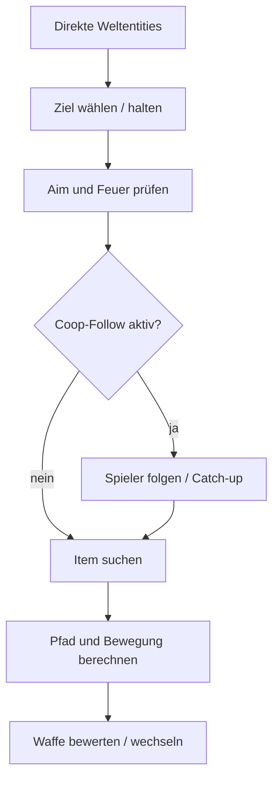

# Combat, Items, Zustände und Schwierigkeitsgrade

Referenz: Cecil 953b477; ssam-Vergleich: Dev-Snapshot ed08e2. Alle folgenden Befunde sind Quellbefunde. Native Reproduktion und Spielstärkenvergleich: NOT_TESTED.

## Ablauf und Zustand

PlayerBot.es:117–173 führt zuerst BotThinking, danach BotWeapons, danach BotSelectNewWeapon aus. Aim/Bewegung/Feuer können deshalb noch das Waffenprofil des vorherigen Durchlaufs verwenden. BotStructure.h:26–98 hält Ziel-/Folgeentities, Timer, zuletzt gesehene Informationen, Seitenrichtung, Pfadzeiger, Waffenindex und Itemzustand. Reset initialisiert nur Teile davon; Serialisierung BotStructure.cpp:54–175 ist nicht portabel und enthält beispielsweise m_tmDied nicht.



Dies beschreibt den wesentlichen Ablauf, keine unabhängige originale Behavior-Tree-Datei. ButtonAction hat einen gemeinsamen 0,2-s-Cooldown für mehrere Aktionen (BotStructure.cpp:209–216). Direktes BotSelectNewWeapon ruft WeaponSelectOk und SendEvent(EBegin) auf (:224–242); in ssam stattdessen den regulären WeaponInput-/Actionpfad nutzen.

## Gegnererkennung und Zielwahl

ClosestEnemy (Logic/BotFunctions.cpp:224–312) scannt Weltentities, filtert tote/Templateentities und Spieler/Monster nach Targetmodus. Sichtbarkeit, niedrigere Gesundheit, geringere Distanz und Angriff auf den Bot beeinflussen die Auswahl. Gesundheit und Entfernung werden relativ zum bisher akzeptierten Kandidaten bewertet; >= bei Gleichstand macht Entityreihenfolge relevant. Dies ist keine ordnungsunabhängige globale Utilityfunktion.

Teamfilter vergleichen Teamnamen (:198–213). Ein leeres eigenes Team bedeutet keinen allgemeinen Ausschluss anderer Spieler. „Greift mich an“ kann für Cecil-Bots und Enemy Base aus deren Zielzeiger gelesen werden, nicht aus einer allgemeinen Absichtserkennung menschlicher Spieler. Die frühere Kanonenausnahme ist auskommentiert.

CastBotRay (:164–182) begrenzt auf 1000 Einheiten, nutzt physische Rayprüfung und TT_NONE für Modelle; Endpunkttoleranz 0,1. Unser bestehender TT_COLLISIONBOX-Ray ist nicht identisch. Kein FOV-Filter in dieser Gegnerauswahl gefunden. Zielwechsel-CD ist keine menschliche Reaktionszeit. Bis zwei Sekunden nach Sichtverlust werden aktuelle Zielposition/-geschwindigkeit weiterhin genutzt; das entspricht keinem ausschließlich eingefrorenen Last-Seen-Gedächtnis.

## Waffenwahl

Die vollständigen 30 Tabellenzeilen stehen in exports/weapons.json und .csv. Zwei Tabellen: Deathmatch und Cooperative; Werte sind KI-Parameter, keine gemessenen Retail-DPS.

BotStructure.cpp:245–321 filtert Besitz, erlaubte Waffen, Entfernungsband und Munition; Infinite Ammo überspringt Munitionsprüfung. Bewertung:

```text
score = damage * (accuracy + (1 - accuracy) *
                 (1 - (distance - min_distance) / (max_distance - min_distance)))
```

Höchster Score gewinnt, bei Gleichstand der erste Tabelleneintrag. Daher ist der Kommentar „Order doesn't matter“ nicht uneingeschränkt korrekt. Keine Reload-/Wechselkosten, keine DPS-Modellierung und keine genaue Splash-Selbstschadensrechnung.

| DM-Waffe | Distanz | Damage-Parameter | Accuracy |
|---|---:|---:|---:|
| Sniper | 32–300 | 150 | 1,00 |
| Doppel-Schrot | 0–32 | 100 | 0,60 |
| Minigun | 0–300 | 30 | 0,85 |
| Cannon | 16–128 | 300 | 0,40 |
| Granatwerfer | 12–128 | 100 | 0,30 |
| Raketenwerfer | 12–96 | 70 | 0,20 |
| Colt | 0–500 | 20 | 0,90 |

Nach >2 Sekunden ohne gesehenes Ziel wird in DM das Messer bevorzugt (:257–269). Reisen mit Messer bedeutet nicht automatisch dauernde Aktivität. Cecil verhindert Colt-Fernschüsse nicht grundsätzlich: Reichweite bis 500.

Feuer: BotWeapons.cpp:92–119 setzt PLACT_FIRE; Special ist weitgehend Platzhalter. Granatwerfer verwendet einen besonderen Halte-/Loslasszyklus über m_tmShootTime (BotStructure.cpp:399–419), nicht bloß einen universellen Einsekundentakt. Scopefunktionen verwenden die normalen Sniper-Buttons und den gemeinsamen Button-CD.

## Aim

BotMovement.cpp:229–338:

```text
aim_point = target_center + target_velocity *
            (prediction + random * prediction_random) * (1 - weapon_accuracy)
```

Spieler erhalten Höhenversatz; alle 0,5 Sekunden neuer Richtungsfehler. Scope reduziert Fehler, fehlende Sicht vergrößert ihn. Entfernung beeinflusst Rotationsdivisor; Rotation wird begrenzt. Keine analytische Abfanglösung, keine Projektilgeschwindigkeit, Gravitation, Granatenballistik oder Kollisionsvorhersage. Bei Accuracy=1 entfällt dieses Vorhalten.

Feuerwinkel standardmäßig 15° je Achse; Sicht oder entsprechender Waffen-Ray-Treffer zusätzlich nötig (:329–336). Das ist großzügiger als 3° der aktuellen Legacy-Policy, aber kein Trefferquotenbeweis. Bei längerem Sichtverlust folgt Blick der Bewegung; bei längerem Fall kann er nach unten gehen.

## Bewegung und Taktik

BotMovement.cpp:395–604 kombiniert Follow, Wegpunkt, Item und Gegner. Ohne relevante Ziele Rückkehr bei :397–399: keine Garantie ununterbrochener Aktivität. Strafe-Richtung wechselt zufällig alle 2–4 Sekunden. Waffenband und Gesundheit beeinflussen Strafedistanz; wenig Leben erweitert Ausweichbereich. Keine ausgearbeitete Cover-/Flankenplanung oder koordinierte Teamtaktik.

Sprung, Ducken, Schwimmen und Navflags sind vorhanden. Stuckreaktion verändert Richtung, läuft rückwärts/seitwärts oder springt (:565–584). NoPosChange (:25–30) setzt bei positivem Ergebnis seinen Timer zurück; mehrere Aufrufer teilen dieses zustandsändernde Ereignis. Pitprüfungen sind nicht read-only, siehe NAVIGATION.md.

Coop-Follow enthält zusätzlich einen direkten Catch-up-Teleport: BotStructure.cpp:468–476 ruft bei lebendem Bot und Abstand >200 zum realen Spieler pen->Teleport auf. Dies ist nicht der NAV-Teleportflag und kein normaler Clientbefehl. Dieses Teilverhalten ist Kategorie E; reguläres Folgen bleibt C.

Respawn: PlayerBot.es erzeugt abhängig von Todeszustand und Presetverzögerung Feuer-/Wiederbelebungsaktionen; Singleplayer verwendet zusätzliche Entityevents. Der normale Multiplayer-Respawn muss über unsere vorhandenen Vanilla-Buttons geprüft werden. Todes-/Slot-/Entity-Lifetime nicht aus dem eigenen CPlayerBot übernehmen.

Nicht gefunden: langfristiges Lernen, vollständiger Behavior Tree, Covergraph, echte koordinierte Rollen, vorausschauendes Itemrespawn-Timing, allgemeine ballistische Lösung. Das bedeutet nicht, dass keine einfache Taktik existiert: Target-, Distanz-, Strafe-, Item- und Followregeln sind implementiert.

## Items

GetClosestItem (BotItems.cpp:121–201), ClosestItemType (:204–249):

1. Waffe innerhalb Suchreichweite und näher als Gegner.
2. Gesundheit bei unterschrittener Suchschwelle.
3. Powerup.
4. Rüstung.
5. AmmoPack, andernfalls normale Ammo.

Filter: Typ, Sichtbarkeit/Pickupmaske, Distanz, optional LOS. Vertikaler Abstand wird dreifach gewichtet. Ausgewähltes Item wird verfolgt, solange aufnehmbar; erfolgreiche Auswahl setzt gewöhnlich 5 Sekunden Such-CD. Erfolglose Suche kann wiederholt Welt-/Rayabfragen auslösen.

Grenzen und Randfälle:

- Waffenaufnahme prüft nicht allgemein, ob das vorhandene Loadout besser wird.
- Keine präzise Zuordnung der Munition zum tatsächlichen Mangel, keine Reservierung zwischen Bots.
- Nächster Kandidat einer Klasse wird geprüft; bei ungeeignetem Wert wird nicht automatisch der zweitnächste geeignete gewählt.
- Ein vorhandenes, aber zu fernes AmmoPack verhindert die Suche nach normaler Munition (:188–196).
- Health-/Armor-Bedingungen überlappen: kleiner Pickup <=10 kann bei 75–84 über den <=50-Zweig akzeptiert werden (:142–148 / :175–181).
- m_penLastItem wird nach seiner Prüfung zurückgesetzt (:244–247); keine dauerhafte Blacklist.
- Itempositionen stammen aus Laufzeitentities. NAV-Important-ID enthält keinen Waffennamen.

## Konfiguration

Vier Presets, keine sechs ausgearbeiteten Cecil-Persönlichkeiten. Vollständige Zuweisungen: exports/settings.json und .csv. Konstruktorfelder b3rdPerson=TRUE, iCrosshair=-1, bAvoidPits=FALSE werden von Reset nicht überschrieben.

| Einstellung | Dummy | Easy | Normal | Hard |
|---|---:|---:|---:|---:|
| Respawnverzögerung | 0 | 3 | 1 | 0 |
| Schießen | aus | an | an | an |
| Accuracy-Angle | 5 | 10 | 5 | 2 |
| Waffenwechsel-CD | 3 | 5 | 3 | 3 |
| Zielwechsel-CD | 1 | 3 | 1 | 1 |
| Prediction | 0,1 | 0,2 | 0,1 | 0,5 |
| Prediction-Zufall | 0,1 | 0,5 | 0,1 | 0 |
| Strafe | an | aus | an | an |
| Health-Suchschwelle | 100 | 50 | 80 | 100 |

Gemeinsam: Shoot-Angle15, Item-CD5, Waffen-Suchdistanz16. Dummy besitzt trotz Suchflags teilweise Suchdistanzen0. Variation entsteht durch Parameter, Zufall und transienten Zustand.

## Statische Risiken bei unveränderter Kopie

Diese Befunde sind **nicht nativ reproduziert**:

| Befund | Quelle | Prüfung vor Übernahme |
|---|---|---|
| Reset setzt Waffenindex auf CT_BOT_WEAPONS, also hinter Array | BotStructure.h:91; BotThinking cpp:387 vor BotWeapons | Spawn/Respawn mit Sanitizer, gültiges Startprofil |
| WEAPON_NONE=0 bei 1 << (weapon-1) | BotWeapons.h:59; BotStructure.cpp:279–287 | Negative Shift vermeiden, Enumgrenzen testen |
| Neue Kandidatendistanz bei noch altem Ziel während CD | BotStructure.cpp:337–345 | Ziel+Distanz atomar als Paar |
| Früher Kandidaten-LOS nutzt initiale Nullbox | BotFunctions.cpp:25,164–182,273; BotStructure.cpp:362–366 | Eigener Zielpunkt pro Kandidat |
| Item-LOS nutzt dieselbe Targetbox | BotItems.cpp:224 | Itembezogene Box/Position |
| Aim/Feuerprofil vor tatsächlichem Waffenwechsel | PlayerBot.es:125–130 | Current/desired/generation unterscheiden |

Originalalgorithmus und bewusste Fehlerkorrektur müssen getrennt versioniert werden. Sicherheitshalber korrigiertes Verhalten ist kein byte-/ablaufidentischer Port.

## ssam-Vergleich und konkrete Empfehlung

Legacy SelectWeapon (botcore_ai.h:132–144) enthält weder Raketenwerfer, Granatwerfer, Cannon noch Flamer/Doppel-Colt. Supply zählt dagegen Waffen4..14 als erfolgreiches Upgrade und beendet sich danach (bot_redstation_behavior.h:8–11; bot_supply_navigation.h:23). **Pickup-Erfolg und Kampffähigkeit sind damit inkonsistent.** Historische Livebeobachtung passt dazu, ersetzt aber keinen neuen Runtime-Test.

Der vorhandene Human-Modus besitzt bereits geschwindigkeitsbezogenes Vorhalten distance/proj_speed (bot_human.h:233–240), Zielhysterese (:288–327), Low-HP-Rückzug (:336–341) und Loadout-Dwell/Margin (bot_loadout.h:143–189). Keine pauschale Cecil-Überlegenheit behaupten.

Ein eigener statischer Human-Befund: der Personality-Range-Faktor (bot_loadout.h:109–112) multipliziert bei gleicher Distanz alle Waffenscores gleich. Er ändert daher die Rangfolge und Wechselmarge nicht; andere Personality-Effekte bleiben vorhanden. Das ist ein Reviewpunkt, keine Aufforderung zum ungeprüften Umbau.

Empfehlung: konsistente WeaponCapability-/Pickupregeln zuerst, danach Cecil-Auswahlregeln als isolierte Policy mit Vergleichsfixture. Originales Aim optional als Referenzmodus, vorhandene Human-Funktionen nicht ohne Messung entfernen.
